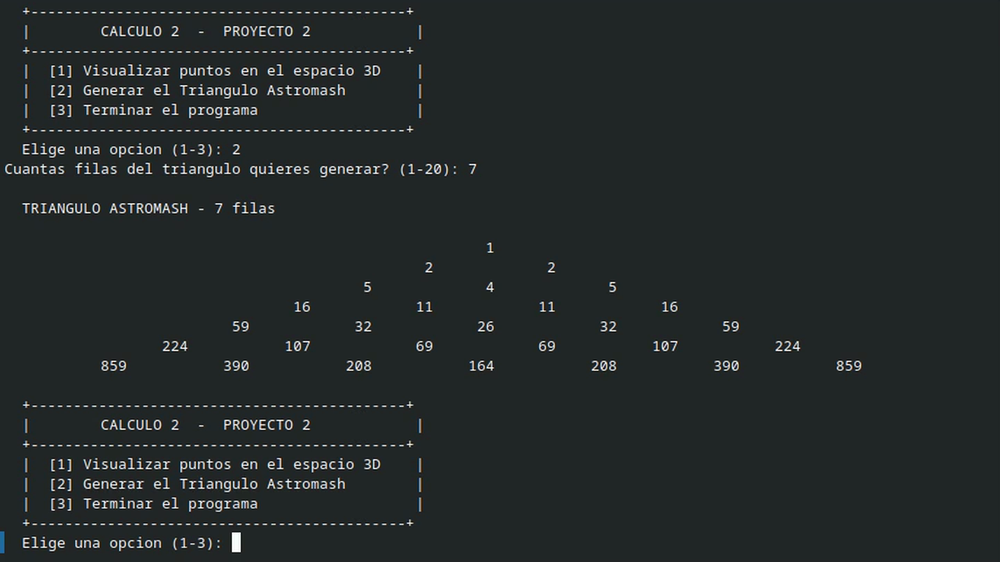
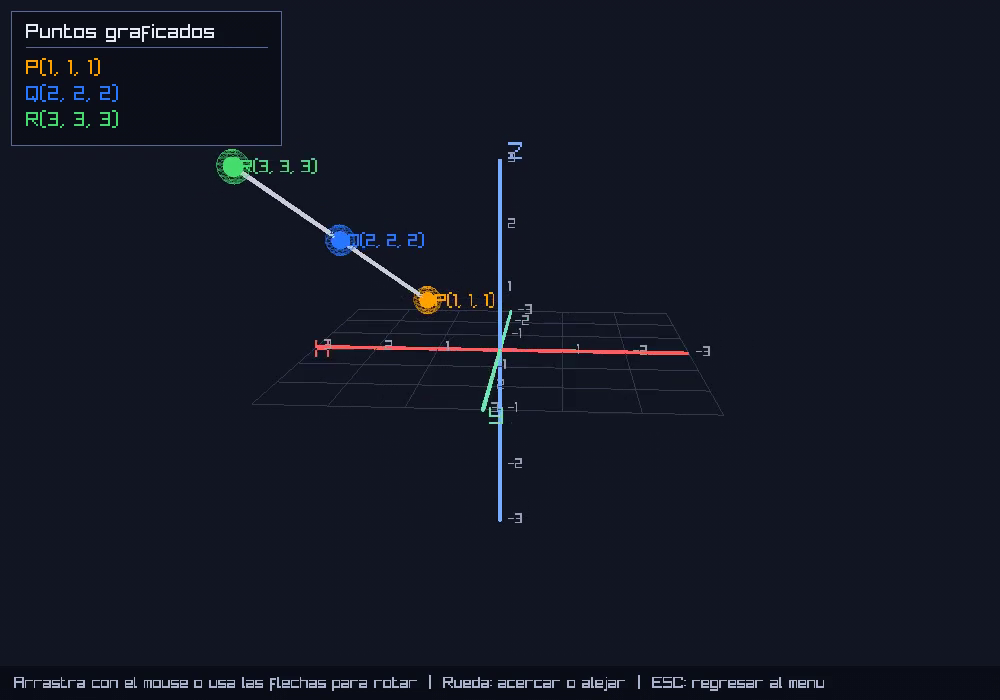
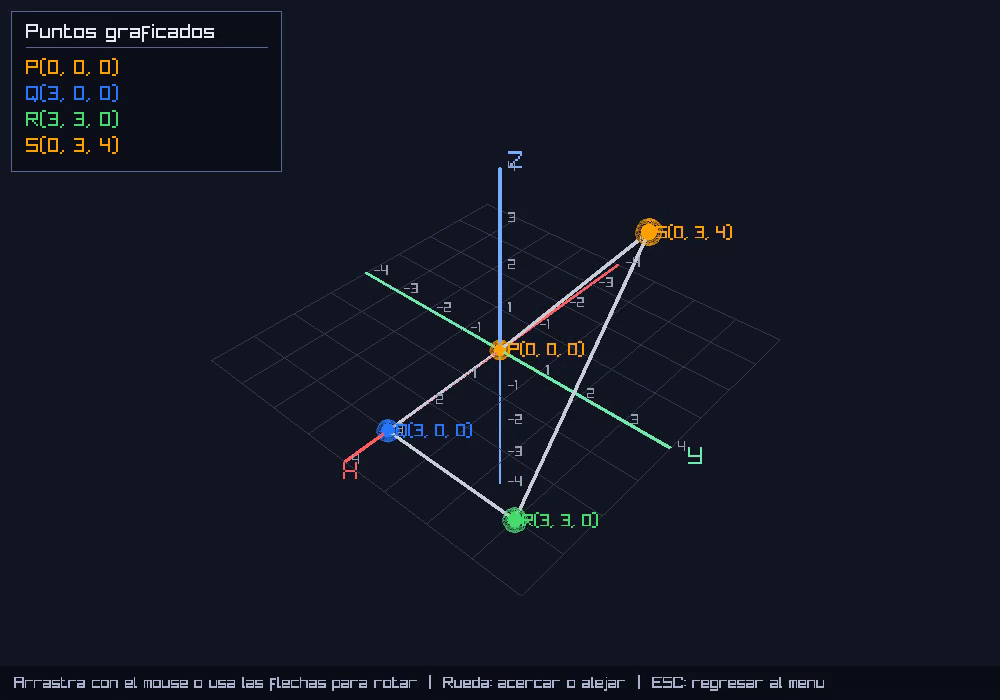

# Calculo 2 - Proyecto 2

Programa en C++ con dos modulos:

1. **Visualizador de puntos en 3D**: grafica de 1 a 10 puntos en el espacio y los une con lineas. Los tres primeros llevan los colores del enunciado: **P anaranjado, Q azul, R verde** (despues los colores se repiten).
2. **Triangulo Astromash**: genera el triangulo numerico de hasta 20 filas.

Todo el codigo esta en un solo archivo, [`main.cpp`](main.cpp). El enunciado esta en [`PROYECTO 2.pdf`](PROYECTO%202.pdf).

**Restricciones del enunciado que cumple:** no usa vectores, matrices (arreglos), recursividad ni memoria dinamica (pilas y colas). Los datos que normalmente irian en un arreglo se guardan en archivos temporales (`*.tmp`) y se leen de forma secuencial; se borran solos al terminar.

---

## Demostracion

**[Ver el video de demostracion](evidencias/video_demostracion.mp4)** (60 segundos): el menu, el Triangulo Astromash y la ventana 3D girando con teclado y mouse.

### Capturas

**Menu y Triangulo Astromash (7 filas)**



**Puntos P(1,1,1), Q(2,2,2) y R(3,3,3) en la ventana 3D**



**Figura cerrada de 4 puntos: P(0,0,0), Q(3,0,0), R(3,3,0) y S(0,3,4)**



---

## Ejecutar sin compilar (binarios listos)

Los ejecutables ya compilados estan en la carpeta [`dist/`](dist). No hay que instalar nada.

### Linux (x86-64)

```bash
chmod +x dist/proyecto2-linux
./dist/proyecto2-linux
```

- Necesita un escritorio grafico (X11 o XWayland) para abrir la ventana 3D, y glibc 2.27 o mas nueva (cualquier distribucion de los ultimos anios).
- No sirve en equipos ARM ni en Alpine Linux.

### Windows (64 bits)

- Doble clic en `dist\proyecto2-windows.exe`, o desde una terminal:

  ```bat
  cd dist
  proyecto2-windows.exe
  ```

- Como el archivo no esta firmado, Windows SmartScreen puede mostrar un aviso la primera vez: "Mas informacion" -> "Ejecutar de todas formas".

---

## Compilar manualmente

Se necesita un compilador de C++ (g++) y, solo si se quiere la **ventana 3D**, la libreria [raylib](https://www.raylib.com/) (version 4.0 o mas nueva).

El programa detecta solo si existe `raylib.h`:

| Situacion | Resultado |
|---|---|
| raylib disponible | Ventana 3D con tema oscuro |
| raylib no disponible | Grafica en la consola (solo biblioteca estandar) |

### Linux

**Version de consola** (sin instalar nada):

```bash
g++ main.cpp -o proyecto2 -DSIN_VENTANA
./proyecto2
```

**Version con ventana 3D:**

```bash
# Fedora
sudo dnf install raylib-devel
# Ubuntu / Debian: instalar el paquete libraylib-dev (si su version no lo trae, compilar raylib desde su codigo fuente)

g++ main.cpp -o proyecto2 -lraylib -lGL -lm -lpthread -ldl
./proyecto2
```

### Windows

Instalar un compilador MinGW, por ejemplo [w64devkit](https://github.com/skeeto/w64devkit) o [MSYS2](https://www.msys2.org/), y abrir su terminal en la carpeta del proyecto.

**Version de consola:**

```bat
g++ main.cpp -o proyecto2.exe -static -DSIN_VENTANA
proyecto2.exe
```

**Version con ventana 3D** (raylib con el [instalador oficial](https://github.com/raysan5/raylib/releases) o, en MSYS2, `pacman -S mingw-w64-ucrt-x86_64-raylib`):

```bat
g++ main.cpp -o proyecto2.exe -static -lraylib -lopengl32 -lgdi32 -lwinmm
proyecto2.exe
```

Si el compilador no encuentra `raylib.h` o la libreria, agregar las rutas con `-I<ruta>/src` y `-L<ruta>/src`.

### Notas de compilacion

- `-DSIN_VENTANA` fuerza la version de consola aunque raylib este instalada. Si `raylib.h` esta instalada y se compila **sin** `-lraylib` (y sin `-DSIN_VENTANA`), el enlace falla: usar uno de los comandos de arriba.
- `-static` en Windows evita que el `.exe` necesite DLLs de MinGW junto al programa.

---

## Como se usa

Al iniciar aparece el menu:

```
  +--------------------------------------------+
  |        CALCULO 2  -  PROYECTO 2            |
  +--------------------------------------------+
  |  [1] Visualizar puntos en el espacio 3D    |
  |  [2] Generar el Triangulo Astromash        |
  |  [3] Terminar el programa                  |
  +--------------------------------------------+
```

### [1] Visualizar puntos en el espacio 3D

1. Indica cuantos puntos vas a ingresar (1 a 10).
2. Escribe las coordenadas de cada uno como tres numeros separados por espacios (`x y z`).
3. Si ingresaste 3 o mas, el programa pregunta si quieres unir el ultimo punto con el primero (`s`/`n`).
4. Se abre la grafica.

Ejemplo: P(1,1,1), Q(2,2,2), R(3,3,3) -> se escribe `1 1 1`, `2 2 2` y `3 3 3`; los tres puntos aparecen alineados y unidos.

**Ventana 3D:**

| Accion | Control |
|---|---|
| Girar la vista | Arrastrar con el boton izquierdo del mouse, o flechas del teclado |
| Acercar / alejar | Rueda del mouse |
| Regresar al menu | `ESC` |

**Grafica en consola** (cuando no hay raylib): primero pregunta si la terminal soporta colores (`n` muestra el color de cada punto escrito entre corchetes). Controles, seguidos de Enter:

| Tecla | Accion |
|---|---|
| `a` / `d` | Rotar a la izquierda / derecha |
| `w` / `s` | Inclinar hacia arriba / abajo |
| `q` | Regresar al menu |

### [2] Triangulo Astromash

Pide el numero de filas (1 a 20) e imprime el triangulo centrado. Las primeras filas son estas (en pantalla el espaciado es mas amplio):

```
                       1
                    2     2
                 5     4     5
             16    11    11    16
          59    32    26    32    59
      224   107    69    69   107   224
```

Regla: las tres primeras filas son `1`, `2 2` y `5 4 5`. Desde la cuarta, cada extremo es la suma de la fila anterior mas el primer valor de la fila de dos antes, y cada valor interior es la suma de los dos de arriba mas el que queda en diagonal dos filas antes.

---

## Estructura del repositorio

```
.
├── main.cpp                 # Todo el codigo del proyecto
├── PROYECTO 2.pdf           # Enunciado
├── README.md
├── .gitignore
├── dist/
│   ├── proyecto2-linux          # Ejecutable para Linux x86-64
│   └── proyecto2-windows.exe    # Ejecutable para Windows 64 bits
└── evidencias/
    ├── video_demostracion.mp4                 # Video del programa funcionando
    ├── captura_1_menu_y_triangulo.png
    ├── captura_2_puntos_PQR_en_3d.png
    └── captura_3_figura_cerrada_en_3d.png
```

Los binarios de `dist/` se compilaron con raylib 5.5 enlazada dentro del ejecutable.
